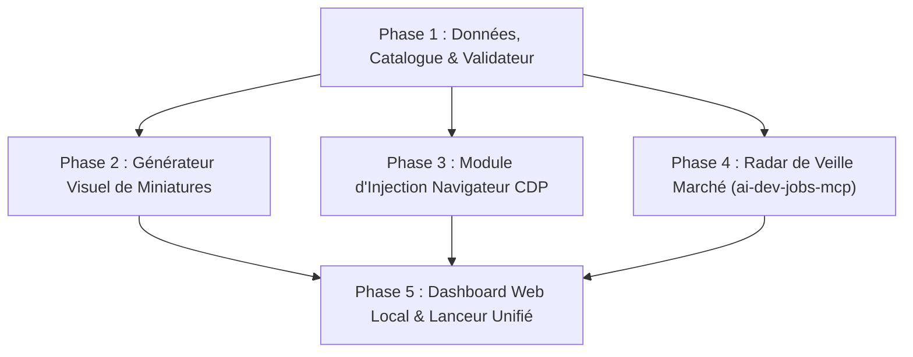

# Plan d'Implémentation : Freelance Gigs Studio (ComeUp & Fiverr)

**Date :** 09 Octobre 2026  
**Document de conception associé :** [docs/freelance-gigs-studio-design.md](file:///d:/works/antigravity/projects/angelo-lock-to-hang-resume/docs/freelance-gigs-studio-design.md)  
**Objectif :** Développer et déployer l'écosystème local Freelance Gigs Studio (Catalogue de fiches, Générateur de miniatures, Injection navigateur CDP, Radar de veille `ai-dev-jobs-mcp`, et Dashboard local).

---

## Architecture des Tâches & Dépendances

---

## Phase 1 : Données, Catalogue des Offres & Validation Canonique

- [x] **Tâche 1.1 : Structure des répertoires**
  - Créer `scripts/freelance-studio/data/gigs/`, `scripts/freelance-studio/core/`, `scripts/freelance-studio/dashboard/`.
  - Configurer `scripts/freelance-studio/package.json` avec les dépendances nécessaires (`express`, `playwright`, `cors`).

- [x] **Tâche 1.2 : Rédaction des Fiches Gigs Maîtresses (JSON)**
  - Créer `data/gigs/ai-rag-agent.json` :
    - Volet ComeUp (FR) : Titre "Je vais créer votre Agent IA sur-mesure et système RAG sécurisé", accroche, description HTML structurée, offre de base (25€), options Pro (150€) et Entreprise (390€), FAQ, garanties.
    - Volet Fiverr (EN) : Titre "I will build custom AI agents and secure RAG pipelines with MCP", tags, packages (Basic $45, Standard $180, Premium $450), description markdown, requirements.
  - Créer `data/gigs/laravel-fullstack.json` :
    - Volet ComeUp (FR) : Titre "Je vais développer ou optimiser votre application web Laravel et React", offre de base (35€), options Standard (180€) et Entreprise (480€), FAQ.
    - Volet Fiverr (EN) : Titre "I will build secure fullstack web apps with Laravel and React", packages ($50 / $190 / $520), description SEO, requirements.

- [x] **Tâche 1.3 : Validateur de Règles (`core/gig-validator.js`)**
  - Vérifier les contraintes de limites de caractères (Fiverr $\le$ 80c pour titre, $\le$ 1200c pour description, tags $\le$ 20c ; ComeUp débutant par "Je vais...").
  - Vérifier la présence de tous les livrables, bonus, et garanties définis dans le framework `offers`.

- [x] **Tâche 1.4 : Exporteur Markdown / HTML (`core/export-gigs.js`)**
  - Générer des fichiers exportés prêts à l'emploi dans `data/output/exports/` pour relecture ou copie manuelle instantanée en cas de besoin.

---

## Phase 2 : Moteur Visuel & Générateur de Miniatures (1280x769 px)

- [ ] **Tâche 2.1 : Gabarit HTML5 / CSS Haute Conversion**
  - Créer un modèle HTML responsive au format $1280 \times 769\text{ px}$.
  - Intégrer :
    - Titre géant à fort contraste (3 à 5 mots clés).
    - Photo de profil détourée avec liséré (réutilisation des assets de `cv-template/assets/`).
    - Badges d'autorité ("6+ Ans d'Expérience", "Production Ready", "100% Testé").
    - Logos officiels vectoriels (Laravel, React, OpenAI, MCP, Python).

- [ ] **Tâche 2.2 : Script de Rendu Automatique (`core/thumbnail-builder.js`)**
  - Utiliser Playwright en mode capture d'écran HD (`page.screenshot()`) pour compiler le template en images `PNG` et `WebP`.
  - Générer 2 déclinaisons graphiques par Gig (Mode Sombre Cyber/Tech vs Mode Bleu Corporate Pro).

- [ ] **Tâche 2.3 : Vérification et Validation Visuelle**
  - Contrôler le rendu visuel et la netteté des miniatures générées dans `data/output/thumbnails/`.

---

## Phase 3 : Module d'Injection Navigateur Sécurisé (CDP)

- [ ] **Tâche 3.1 : Cartographie des Sélecteurs (`core/selectors.json`)**
  - Définir les sélecteurs DOM pour ComeUp (`/dashboard/services/nouveau`) : champ titre, catégorie, description riche, prix de base, ajout d'options, upload de miniature.
  - Définir les sélecteurs DOM pour Fiverr (`/manage_gigs/new`) : gig title, category, search tags, scope & pricing (3 packages), description, requirements, gallery upload.

- [ ] **Tâche 3.2 : Script de lancement Chrome Debug (`scripts/start-chrome-debug.bat`)**
  - Script simple lançant Chrome avec le port de débogage activé (`--remote-debugging-port=9222`) et profil isolé.

- [ ] **Tâche 3.3 : Injecteur Playwright CDP (`core/browser-injector.js`)**
  - Raccordement sur `http://localhost:9222`.
  - Simulation de frappe naturelle avec délais progressifs.
  - Remplissage des champs textuels, sélection des catégories, renseignement des tableaux de prix.
  - Injection du fichier image de la miniature.
  - Clic automatique sur **"Enregistrer comme brouillon"** (arrêt strict avant publication finale).

---

## Phase 4 : Radar de Veille Marché (`ai-dev-jobs-mcp` & Flux)

- [ ] **Tâche 4.1 : Client MCP Remote (`core/market-radar.js`)**
  - Interroger l'endpoint `https://aidevboard.com/mcp` (outils `search_jobs`, `get_stats`) pour récupérer les missions freelance et postes contractuels en IA/ML/RAG.
  - Normaliser les offres reçues (titre, entreprise, TJM/salaire estimé, technologies, lien de postulation).

- [ ] **Tâche 4.2 : Système de Scoring & Déduplication**
  - Algorithme de correspondance avec vos compétences phares (Laravel, PHP, RAG, MCP, React).
  - Filtrage anti-doublon et journalisation locale des opportunités détectées.

---

## Phase 5 : Dashboard Web Local & Lanceur Unifié

- [ ] **Tâche 5.1 : Backend Express Local (`dashboard/server.js`)**
  - Exposer l'API REST locale :
    - `GET /api/gigs` : Liste des services et détails.
    - `POST /api/thumbnails/generate` : Déclenchement du rendu des miniatures.
    - `POST /api/gigs/inject` : Lancement de l'injection CDP pour une plateforme donnée.
    - `GET /api/jobs` : Liste des opportunités captées par le radar.

- [ ] **Tâche 5.2 : Frontend Interactif (`dashboard/public/index.html`)**
  - Onglet **Gigs Studio** : Affichage bilingue FR/EN, aperçu miniature, bouton `⚡ Injecter Brouillon`.
  - Onglet **Radar Opportunités** : Liste filtrable des opportunités tech/IA.
  - Onglet **Offre & Psychologie** : Tableau récapitulatif des leviers de la Value Equation.

- [ ] **Tâche 5.3 : Lanceur Global Windows (`open-studio.bat`) & Tests de Bout en Bout**
  - Script batch exécutable en un double-clic ouvrant le dashboard dans le navigateur.
  - Test de validation complet sur l'ensemble de la chaîne.
